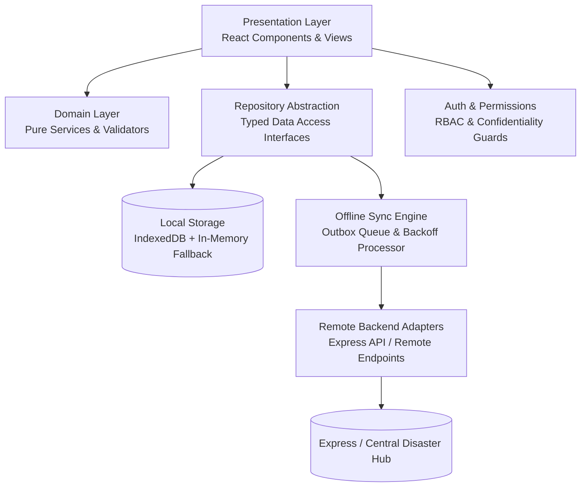
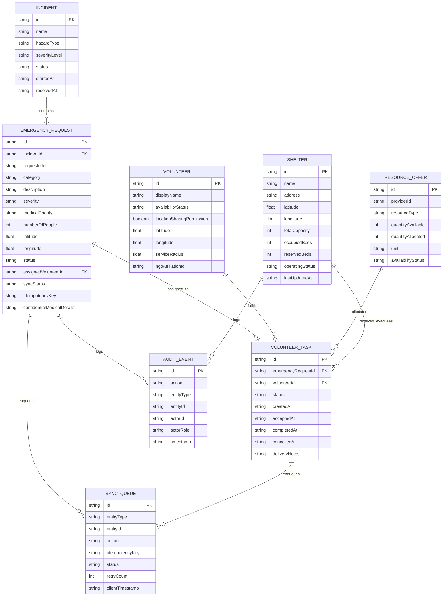
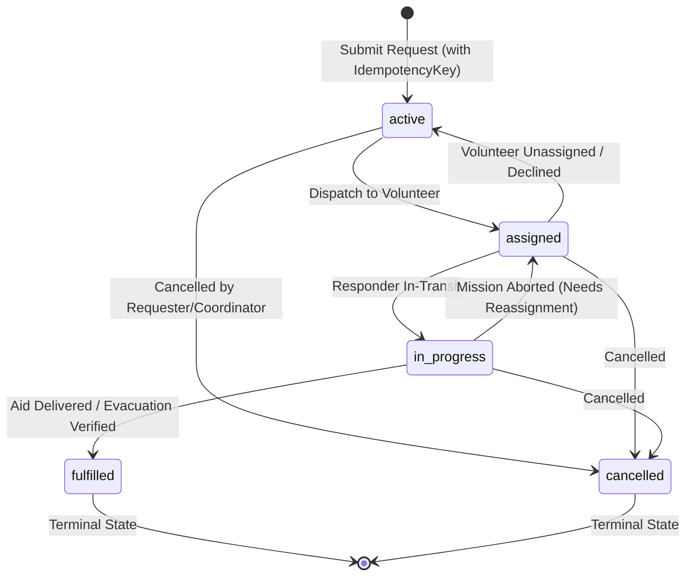
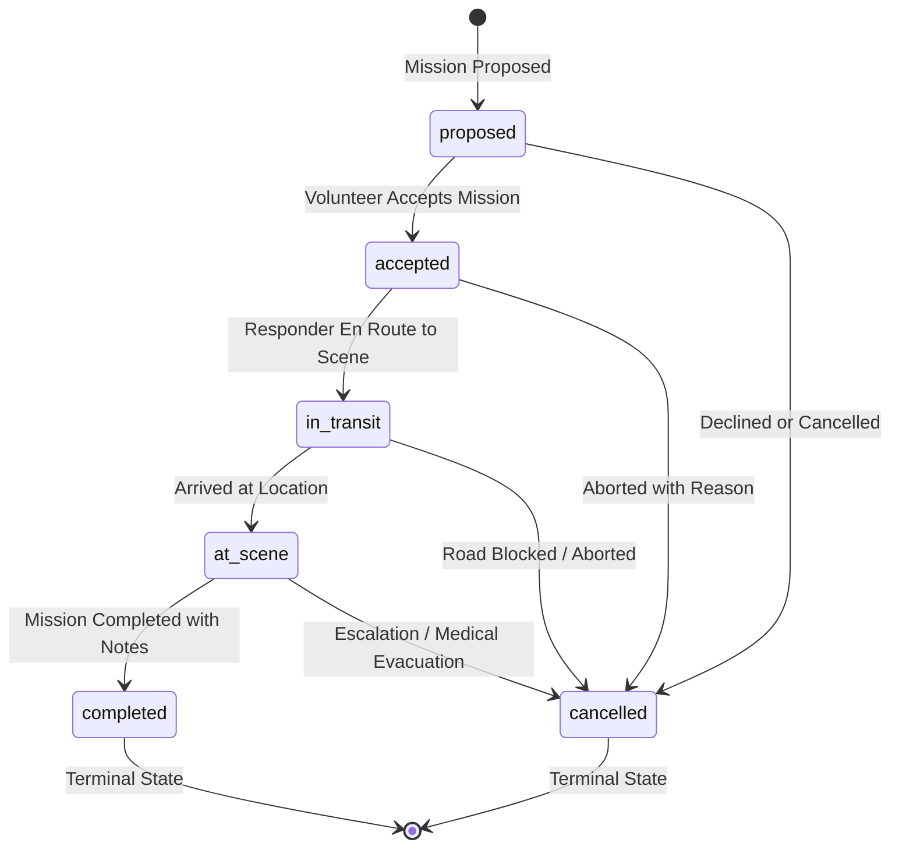
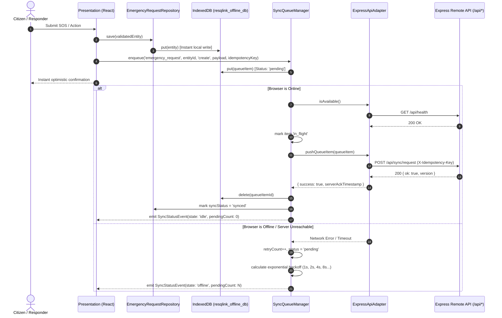

# ResQLink — System Architecture & Data Layer Specification

> **Disaster-Response & Peer-to-Peer Neighborhood Resource-Matching Progressive Web App**

---

## 1. Architectural Philosophy

ResQLink is built for disaster zones where network infrastructure is brittle, intermittent, or completely severed. The application employs an **Offline-First, Zero-Data-Loss Architecture** where all user interactions (submitting emergency SOS alerts, claiming volunteer tasks, logging shelter occupancy, updating relief inventory) are committed synchronously to a durable local storage layer and reconciled asynchronously with upstream emergency servers when connectivity is available.

### Decoupled Layering

---

## 2. Layered Responsibilities

| Layer | Directory | Responsibilities | Dependencies |
| :--- | :--- | :--- | :--- |
| **Presentation** | `src/components/`, `src/App.tsx` | UI rendering, user interaction, alerts, responsive layouts, audio broadcast playback. | Consumes Repositories, Domain Services, Auth. |
| **Domain Models** | `src/domain/models/` | Strictly typed interfaces: `EmergencyRequest`, `Volunteer`, `ResourceOffer`, `Shelter`, `VolunteerTask`, `Incident`, `SyncMetadata`, `AuditEvent`. | Zero runtime dependencies. |
| **Domain Services & Logic** | `src/domain/services/` | Business rules: bed reservations, resource allocations, atomic task assignment, coordinate obfuscation, medical isolation. | Domain models, validators. |
| **Domain Validators** | `src/domain/validation/` | Pure validation functions: coordinate boundaries, severity ratings, state machine transitions, capacity constraints. | Domain models. |
| **Local Storage** | `src/storage/indexeddb/` | Promise-wrapped IndexedDB engine (`resqlink_offline_db`) with schema versions, multi-index support, and in-memory fallback. | Browser IDB API. |
| **Repositories** | `src/storage/repositories/` | Decoupled query access: `EmergencyRequestRepository`, `ShelterRepository`, `VolunteerRepository`, `ResourceOfferRepository`, `VolunteerTaskRepository`, `SyncQueueRepository`, `AuditEventRepository`. | Storage engine. |
| **Synchronization** | `src/sync/` | Outbox FIFO processing, exponential backoff, network status subscriptions, remote backend adapters. | Repositories, Domain models. |
| **Security & Auth** | `src/auth/` | Role-based authorization (`coordinator`, `volunteer`, `shelter_manager`, `requester`, `guest`), medical note restriction. | Domain models. |

---

## 3. Entity Relationship Diagram (ERD)

---

## 4. Finite State Machines

### Emergency Request Lifecycle

### Volunteer Task Lifecycle

---

## 5. Critical Domain Invariants & Rules

1. **Unique Identifiers & UTC Timestamps**:
   - All records have cryptographic UUIDs (`crypto.randomUUID()`).
   - All timestamps are ISO 8601 UTC strings ending in `Z` (`new Date().toISOString()`).

2. **Strict Coordinate Handling**:
   - Missing GPS data (`null` or `undefined`) is explicitly **VALID** per emergency standards.
   - Coordinates are **NEVER fabricated** to placeholder values like `(0, 0)`.
   - Valid coordinates are bounded: Latitude `[-90, 90]`, Longitude `[-180, 180]`.

3. **Shelter Capacity Invariant**:
   $$\text{occupiedBeds} + \text{reservedBeds} \le \text{totalCapacity}$$
   Attempting to reserve or intake beds exceeding this invariant throws a `ShelterDomainError`.

4. **Resource Allocation Bound**:
   $$\text{quantityAllocated} \le \text{quantityAvailable}$$
   Over-allocation is strictly prohibited. Resources are returned to the pool upon mission cancellation.

5. **Atomic Volunteer Assignment**:
   - An emergency request cannot have multiple non-terminal tasks concurrently.
   - A volunteer cannot be dispatched to multiple concurrent in-flight missions (`accepted`, `in_transit`, `at_scene`).

6. **Medical Privacy & Geographic Obfuscation**:
   - Confidential medical notes (`confidentialMedicalDetails`) are accessible only to coordinators and the specifically assigned field responder.
   - Public unauthenticated views receive obfuscated coordinates (rounded to 3 decimal places / ~500m) and sanitized summaries.

---

## 6. Offline Synchronization Architecture

---

## 7. Storage Schema (`resqlink_offline_db`)

| Object Store | Primary Key | Indices |
| :--- | :--- | :--- |
| `emergency_requests` | `id` | `incidentId`, `status`, `severity`, `createdAt`, `syncStatus`, `idempotencyKey` |
| `volunteers` | `id` | `availabilityStatus`, `updatedAt` |
| `resource_offers` | `id` | `category`, `status`, `donorId`, `createdAt` |
| `shelters` | `id` | `status`, `name`, `updatedAt` |
| `volunteer_tasks` | `id` | `emergencyRequestId`, `volunteerId`, `status`, `createdAt` |
| `incidents` | `id` | `status`, `severity`, `type`, `createdAt` |
| `sync_queue` | `id` | `status`, `entityType`, `entityId`, `createdAt` |
| `audit_events` | `id` | `entityType`, `entityId`, `actorId`, `timestamp` |

---

## 8. Verification & Test Suite

All domain rules, capacity invariants, state machines, and synchronization queues are verified using the automated test suite (`src/tests/domain-rules.test.ts`):

- **15 passed, 0 failed** across all core invariant checks.
- Zero external test runner conflicts (executing via native Node test runner with `npx tsx`).
- 100% clean TypeScript compilation (`npm run typecheck`).
