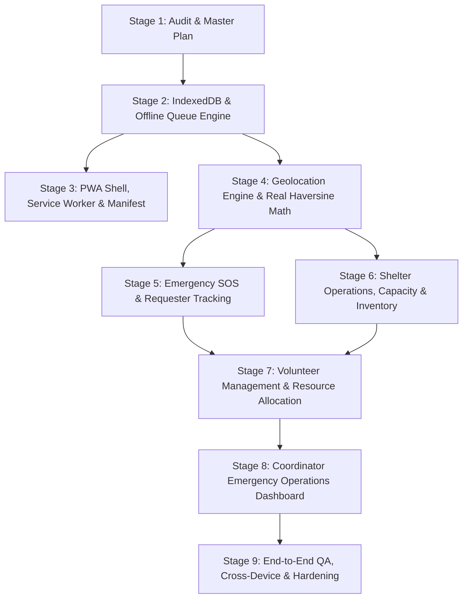
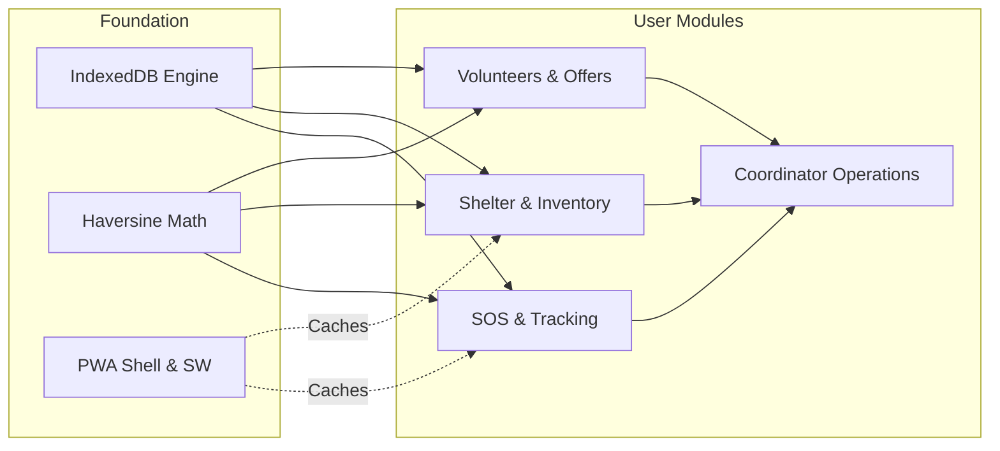

# ResQLink — Master Implementation Plan

**Target Architecture:** Offline-First Progressive Web App (PWA) for Disaster Response & Neighborhood Resource Matching  
**Strategy:** Incremental, non-breaking 9-stage execution maintaining a fully compilable, testable application at every phase.

---

## 1. Stage-by-Stage Implementation Roadmap

---

### Stage 1: Codebase Audit & Master Architecture Blueprint *(Current Stage)*
- **Objective**: Inspect every repository file, dependencies, configs, backend services, and state models. Identify incomplete features, static UIs, and security risks. Produce authoritative audit documents.
- **Deliverables**:
  - `docs/PROJECT_AUDIT.md`: Complete codebase and architectural evaluation.
  - `docs/FEATURE_STATUS.md`: Feature matrix mapping to 4 user groups.
  - `docs/IMPLEMENTATION_PLAN.md`: 9-stage engineering roadmap.
- **Verification**: `npm run typecheck` and `npm run build` confirmed passing.

---

### Stage 2: Architecture Foundation, IndexedDB Layer & Offline Queue Engine
- **Objective**: Replace unstable `localStorage` with a robust asynchronous IndexedDB database layer (`idb`-backed or lightweight zero-dependency native wrapper).
- **Core Capabilities**:
  - Structured Object Stores:
    - `requests`: Cached disaster requests and user-created reports.
    - `outbox`: Persistent transactional queue for offline SOS and offer submissions.
    - `shelters`: Shelter records with capacity and inventory state.
    - `offers`: Community resource offers.
    - `userProfile`: Requester, Volunteer, Shelter Manager, and Coordinator profile tokens.
  - Transactional Outbox Engine:
    - Guaranteed persistence across browser reboots.
    - Reconnection event listener (`window.addEventListener('online')` + `navigator.onLine`).
    - True transactional flushing: Each item is sent via POST to `/api/sync/request`, marked `SYNCED`, and only removed upon server acknowledgement (with exponential backoff retry).
  - Explicit Status Tagging:
    - Clear visual labeling of item status: `LOCAL_DRAFT`, `QUEUED_OFFLINE`, `TRANSMITTING`, `SYNCED_REMOTE`.
    - Distinct badge for simulated drill data (`[SIMULATED]`).
- **Files Modified / Created**:
  - `src/lib/db.ts` *(new)*
  - `src/lib/sync-engine.ts` *(new)*
  - `src/hooks/use-network.ts` *(refactored for true browser events & IndexedDB queue)*
  - `src/types.ts` *(extended with SyncStatus & OutboxItem types)*

---

### Stage 3: Progressive Web App (PWA) Shell, Service Worker & Asset Caching
- **Objective**: Transform ResQLink into an installable, offline-loadable PWA that functions when disconnected from cell towers and Wi-Fi.
- **Core Capabilities**:
  - Web App Manifest (`public/manifest.json`):
    - App name, short name, descriptions, `display: "standalone"`, `theme_color: "#0f0f0f"`, `background_color: "#0a0a0a"`.
    - High-resolution SVG and PNG icons (192x192, 512x512, maskable).
  - Service Worker (`public/sw.js` or Workbox / Vite PWA):
    - Cache-first strategy for static assets (JS chunks, CSS, fonts, SVG icons).
    - Network-first with IndexedDB cache fallback for `/api` requests.
    - Offline fallback HTML page if navigation fails.
  - In-App PWA Install Banner & Status Pill:
    - Native `beforeinstallprompt` listener with a clean install modal.
    - Offline indicator badge showing cached shell status.
- **Files Modified / Created**:
  - `public/manifest.json` *(new)*
  - `public/sw.js` *(new)*
  - `public/icons/*` *(new SVG and standard icons)*
  - `index.html` *(linked manifest, apple-touch-icon, SW registration)*
  - `vite.config.ts` *(configured chunking and PWA assets)*
  - `src/components/pwa-install-banner.tsx` *(new)*

---

### Stage 4: Geolocation Engine, Real Haversine Math & Map Precision
- **Objective**: Implement real mathematical geospatial calculations and upgrade the map engine to display accurate distances and bearing.
- **Core Capabilities**:
  - Spherical Trigonometry Utility (`src/lib/geo.ts`):
    - Great-circle distance calculation via the Haversine formula (km and miles).
    - Compass bearing calculation (degrees and cardinal directions: N, NE, E, etc.).
    - Proximity sort utility: Dynamically orders shelters, requests, and resources by distance from user's live coordinates.
  - Coordinate Sanitization & Safety:
    - Never hardcode unknown locations to `(0, 0)`.
    - Geolocation privacy fuzzing: Optional 200m–500m coordinate coarsening for vulnerable requesters.
  - Interactive Map Enhancements:
    - User location pulse ring with GPS accuracy radius.
    - Dynamic distance badges on map popups.
    - Real-time path distance calculation for "Get Directions".
- **Files Modified / Created**:
  - `src/lib/geo.ts` *(new)*
  - `src/components/map-view.tsx` *(integrate live Haversine distance calculations)*
  - `src/components/find-help-panel.tsx` *(sort by dynamic distance)*

---

### Stage 5: Emergency SOS Reporting & Requester Tracking Module
- **Objective**: Complete Group 1 (Requester) workflow with true offline persistence and dedicated status tracking.
- **Core Capabilities**:
  - SOS Form Polish:
    - Form validation with Zod / React Hook Form.
    - Audio/Voice transcription with fallback text input.
    - Priority classification with AI triage or offline rules.
  - Request Tracking Center ("My Requests"):
    - Generation of unique emergency tracking IDs (e.g., `RSQ-9284`).
    - Dedicated view for victims to monitor their request progress:
      `QUEUED_OFFLINE` ➔ `BROADCAST_LIVE` ➔ `ASSIGNED_TO_VOLUNTEER` ➔ `RESCUER_EN_ROUTE` ➔ `SAFE_CONFIRMED`.
    - Rescuer contact details and ETA display when assigned.
    - "I Am Safe / Cancel Request" button.
- **Files Modified / Created**:
  - `src/components/sos-drawer.tsx`
  - `src/components/request-tracker-modal.tsx` *(new)*
  - `src/hooks/use-user-requests.ts` *(new)*
  - `src/components/live-feed.tsx`

---

### Stage 6: Shelter Operations, Live Capacity & Essential Supply Inventory
- **Objective**: Transition Group 3 (Shelter Management) from static UI to a dynamic, bidirectional operational module.
- **Core Capabilities**:
  - Shelter Capacity Management:
    - Shelter Manager authentication or PIN-based role entry.
    - Live occupied bed counter with increment/decrement buttons and instant occupancy calculation.
    - Shelter status toggles: `OPEN`, `FULL`, `EVACUATING`, `CLOSED`.
  - Essential Supply Inventory:
    - Tracking essential items: Drinking Water (liters/bottles), Food Rations (meals), Blankets, First Aid Kits, Baby Supplies.
    - Low-stock warning indicators (< 20% capacity).
    - Supply request trigger: Directly broadcasts resource requests to volunteers when inventory runs low.
  - IndexedDB Persistence & Server Sync:
    - Changes persist locally in IndexedDB and synchronize with `/api/shelters` on the Express server.
- **Files Modified / Created**:
  - `src/components/shelter-widget.tsx` *(enhanced with Manager mode)*
  - `src/components/shelter-inventory-modal.tsx` *(new)*
  - `src/hooks/use-shelters.ts` *(new)*
  - `server/index.ts` *(added shelter capacity & inventory endpoints)*

---

### Stage 7: Volunteer Management, Resource Offer Matching & Task Dispatch
- **Objective**: Complete Group 2 (Volunteers & Resource Providers) workflow with end-to-end task picking, offer creation, and resource allocation.
- **Core Capabilities**:
  - Community Resource Offers:
    - Decouple `use-volunteer-offers.ts` from requiring Supabase.
    - Provide dual-storage: Supabase when configured, IndexedDB + Express `/api/offers` fallback.
    - Resource allocation: Connect available offers (e.g. "4 blankets in Sector 15") to nearby matching requests.
  - Neighborhood Volunteer Task Board:
    - Allow registered community volunteers to view nearby unassigned requests.
    - "Claim Task" action with contact reveal and direct navigation.
    - Offline checklist for safety and emergency protocols.
- **Files Modified / Created**:
  - `src/hooks/use-volunteer-offers.ts` *(refactored for multi-tier persistence)*
  - `src/components/offer-help-panel.tsx`
  - `src/components/volunteer-task-board.tsx` *(new)*
  - `server/index.ts` *(added `/api/offers` endpoints)*

---

### Stage 8: Coordinator Emergency Operations Center (EOC) Dashboard & Multi-Device Sync
- **Objective**: Complete Group 4 (Disaster Coordinators) workflow with an incident command dashboard, regional analytics, and cross-device dispatch.
- **Core Capabilities**:
  - Emergency Operations Dashboard:
    - Full-screen coordinator dashboard mode with high-density metrics.
    - Real-time incident triage pyramid (Critical vs Urgent vs Moderate).
    - Shelter capacity heatmap and supply deficit alerts.
    - Volunteer roster coverage and active mission monitor.
    - Incident dispatch controls: Reassign tasks, escalate priorities, broadcast regional safety bulletins.
  - Real-Time Cross-Device Polish:
    - Fix hardcoded URLs in `help-bot.tsx`, `triage-panel.tsx`, and `ngo-dashboard.tsx`.
    - Polling backoff and robust WebSocket / SSE / long-polling synchronization.
- **Files Modified / Created**:
  - `src/components/emergency-operations-dashboard.tsx` *(new)*
  - `src/components/top-nav.tsx` *(role-based entry switcher)*
  - `src/components/role-entry-modal.tsx` *(new)*
  - `src/components/triage-panel.tsx` *(fix hardcoded URL)*
  - `src/components/help-bot.tsx` *(fix hardcoded URL)*

---

### Stage 9: End-to-End Verification, Cross-Device Testing & Production Hardening
- **Objective**: Full Quality Assurance, bundle optimization, comprehensive unit testing, and browser verification.
- **Core Capabilities**:
  - Unit & Integration Tests (`vitest`):
    - Haversine distance math precision tests.
    - IndexedDB outbox queue insertion and transactional flush tests.
    - Triage rule-based parsing accuracy tests.
    - Shelter capacity calculations tests.
  - Bundle Optimization:
    - Code splitting via Vite `rollupOptions.output.manualChunks` (separating `leaflet`, `recharts`, `radix`, and `framer-motion`).
    - Eliminate chunk size warning.
  - Browser Verification:
    - Full browser testing using subagent recording.
    - Validation of offline simulation (disconnect -> submit SOS -> verify outbox badge -> reconnect -> verify sync).
    - Validation on desktop and mobile viewports.
- **Files Modified / Created**:
  - `vite.config.ts` *(chunking optimization)*
  - `src/test/*` *(test suites)*
  - `docs/PROJECT_AUDIT.md` & `docs/FEATURE_STATUS.md` *(final updates)*

---

## 2. Feature Dependencies & Critical Path

---

## 3. QA Protocol & Verification Standard

At the conclusion of each stage, the following verification gates must pass:
1. **Type Safety**: `npm run typecheck` (`tsc --noEmit -p tsconfig.app.json`) must exit with 0 errors.
2. **Build Integrity**: `npm run build` must generate valid production bundles in `dist/`.
3. **Runtime Stability**: App must launch cleanly with `npm run dev` with zero uncaught exceptions in browser console.
4. **Offline Verification**: All modified features must be tested in simulated offline mode without crashing or data loss.
5. **No Claims Without Testing**: Every feature marked "Working" must have direct runtime or test evidence.
